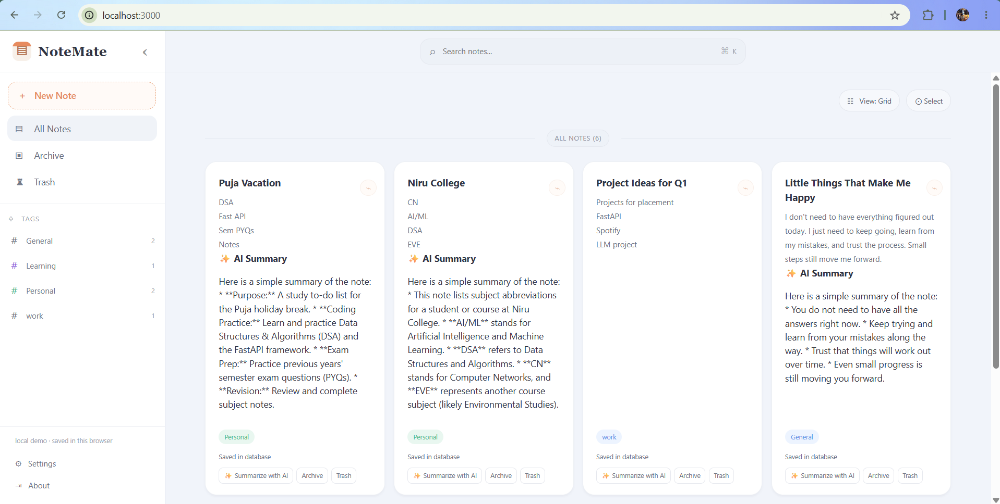

# NoteMate — AI-Powered Note Management App

NoteMate is a full-stack note management application built with FastAPI, PostgreSQL, React, and Gemini AI.

## Screenshots

## Features

- Create, view, update, and delete notes.
- Store notes in PostgreSQL.
- Organize notes with tags and pinned notes.
- Generate AI summaries using Gemini.

## Tech Stack

- **Frontend:** React, Axios
- **Backend:** Python, FastAPI
- **Database:** PostgreSQL
- **ORM:** SQLAlchemy
- **AI:** Google Gemini API

## Setup

1. Clone the repository.
2. Create and activate a Python virtual environment.
3. Install backend dependencies.
4. Create a `.env` file containing `DATABASE_URL` and `GEMINI_API_KEY`.
5. Start the backend with `uvicorn main:app --reload`.
6. Start the frontend from `notemate-frontend` using `npm install` and `npm start`.

## API Endpoints

| Method | Endpoint | Description |
|---|---|---|
| GET | `/notes` | Retrieve all notes |
| GET | `/notes/{id}` | Retrieve one note |
| POST | `/notes` | Create a note |
| PUT | `/notes/{id}` | Update a note |
| DELETE | `/notes/{id}` | Delete a note |
| POST | `/notes/{id}/summarize` | Generate an AI summary |

## Limitations

- Uses PostgreSQL rather than MongoDB.
- AI summarization requires a valid Gemini API key and available quota.
- Authentication is not implemented.

## Author

Developed as a learning project using FastAPI, React, PostgreSQL, and Gemini AI.
